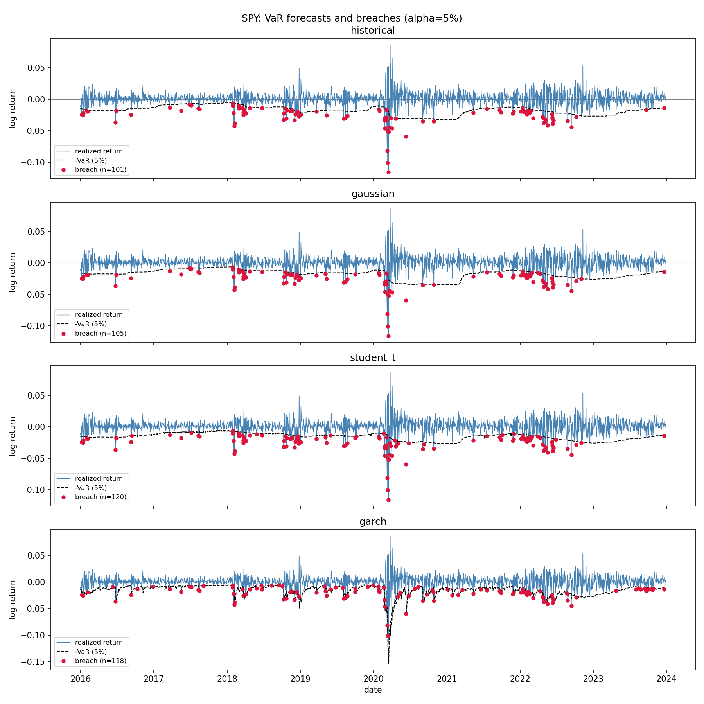

# risk-model-backtesting

Rigorous backtesting of one-day Value-at-Risk (VaR) and Expected Shortfall
(ES) models: is a risk number actually trustworthy?

## The question

A risk model spits out "tomorrow's 1-day 95% VaR is 2.3%." How do you know
whether to believe it? Three things have to be true:

1. **Rate** — breaches (actual loss exceeding forecast VaR) should happen at
   roughly the rate implied by alpha (e.g. 5% of days for a 95% VaR).
2. **Independence** — breaches should not cluster. A model that breaches 10
   days in a row during a crash and is silent otherwise has the right
   average rate but is dangerously wrong about *when* risk is high.
3. **Severity** — on the days a breach does happen, the ES forecast should
   be an accurate estimate of how bad the loss actually is. A model can get
   the rate and timing right and still badly underestimate tail severity.

This project forecasts one-day VaR/ES with four models of increasing
sophistication, then formally tests all three properties against realized
returns.

## Method

- **Data**: daily adjusted-close prices → 1-day log returns for a single
  ticker, walk-forward (rolling window, no lookahead).
- **Models**: historical simulation, Gaussian (parametric normal), Student-t
  (fat-tailed parametric), GARCH(1,1) (conditional volatility).
- **Backtests**:
  - Kupiec (1995) proportion-of-failures (POF) test — is the breach rate
    correct?
  - Christoffersen (1998) independence test — are breaches i.i.d., or do
    they cluster?
  - Christoffersen conditional coverage (CC) test — joint test of both.
  - McNeil-Frey (2000) bootstrap ES test — is the forecast severity of a
    breach accurate on average?

## Results

`python run.py --ticker SPY --alpha 0.05 --window 250 --start 2015-01-01`
(2013 rolling forecasts, 2016–2023):

| model | expected breaches | actual | Kupiec p | Christoffersen p | ES p | verdict |
|---|---|---|---|---|---|---|
| historical | 100.7 | 101 | 0.9715 | 0.0000 | 0.0240 | FAIL independence, severity |
| gaussian | 100.7 | 105 | 0.6586 | 0.0000 | 0.0000 | FAIL independence, severity |
| student_t | 100.7 | 120 | 0.0545 | 0.0000 | 0.8027 | FAIL independence |
| garch | 100.7 | 118 | 0.0838 | 0.4197 | 0.0000 | FAIL severity |



## Key finding

No model passes all three tests, and the two closest results fail in
opposite ways. Historical, Gaussian, and GARCH all get the breach *rate*
roughly right, but historical and Gaussian breaches cluster tightly around
the March 2020 crash (Christoffersen p ≈ 0) — a constant-width band fit to
unconditional history can't react to a sudden change in volatility regime.

GARCH(1,1) is built to react to exactly that: by forecasting conditional
volatility, its VaR band widens during the crash and narrows afterward, so
its breaches are independent (p = 0.42) — the only model to clear that bar.
But GARCH here still assumes *Gaussian* shocks once volatility is accounted
for, and that assumption is wrong: even after conditioning on volatility,
realized breach-day losses are worse than a Gaussian tail predicts, so it
fails the severity test decisively (p ≈ 0). Student-t is the mirror image —
its fat-tailed distribution correctly sizes breach severity (p = 0.80, the
only pass), but because it's still fit to the unconditional window it
doesn't react to the volatility regime shift any better than Gaussian does,
and also fails independence.

In other words: getting the *timing* of risk right (GARCH) and getting the
*size* of tail losses right (Student-t) came from two different mechanisms
here, and neither model has both. The natural next experiment — supported
by the existing code via `garch_var_es(window, alpha, dist="t")` — is GARCH
with Student-t innovations instead of Gaussian ones, which should combine
conditional volatility with fat tails and might be the first model to pass
all three tests.

## Limitations

- Single-asset, single-ticker analysis — no portfolio effects.
- The Christoffersen independence test and the McNeil-Frey ES test are both
  measurably conservative at these sample sizes: simulating well-calibrated
  synthetic sequences at n≈200-2000 gave false-positive rates of ~1.8% and
  ~2.5% respectively against a nominal 5% significance level. A single
  "PASS" at this sample size is suggestive, not definitive.
- GARCH is only tested with Gaussian innovations here (`dist="normal"`,
  the default); the code supports Student-t innovations
  (`dist="t"`) but that combination isn't in the current results — see Key
  finding above.
- No regime-switching or structural-break handling in the GARCH model.
- Model parameters are refit on every rolling window — no parameter
  stability analysis.

## Reproduce

```bash
python -m venv .venv && source .venv/bin/activate
pip install -r requirements.txt -r requirements-dev.txt
python run.py --ticker SPY --alpha 0.05 --window 250 --start 2015-01-01
pytest
```

## Possible extensions

- **GARCH with Student-t innovations**: add `"garch_t"` to `run.py`'s
  `MODELS` dict as `lambda w, a: garch_var_es(w, a, dist="t")` and re-run —
  the natural follow-up to the severity result above.
- **Extreme Value Theory**: fit a Generalized Pareto Distribution to
  exceedances over a high threshold (Peaks-Over-Threshold) and derive
  VaR/ES from the tail fit instead of the full return distribution — the
  standard next step beyond parametric/historical methods in McNeil, Frey &
  Embrechts, and typically strongest in the very far tail (e.g. alpha=0.01
  or lower) where sample quantiles get noisy.
- **Multiple tickers / asset classes**: re-run across a few names with
  different tail behavior (a single stock, something less liquid, a
  non-equity) to check whether the GARCH-wins-independence /
  Student-t-wins-severity split holds generally or is SPY-specific.

## References

- Kupiec, P. (1995). "Techniques for Verifying the Accuracy of Risk
  Measurement Models." *Journal of Derivatives*, 3(2), 73-84.
- Christoffersen, P. F. (1998). "Evaluating Interval Forecasts."
  *International Economic Review*, 39(4), 841-862.
- McNeil, A. J., & Frey, R. (2000). "Estimation of Tail-Related Risk
  Measures for Heteroscedastic Financial Time Series: An Extreme Value
  Approach." *Journal of Empirical Finance*, 7(3-4), 271-300.
- McNeil, A. J., Frey, R., & Embrechts, P. *Quantitative Risk Management:
  Concepts, Techniques and Tools.* Princeton University Press.
